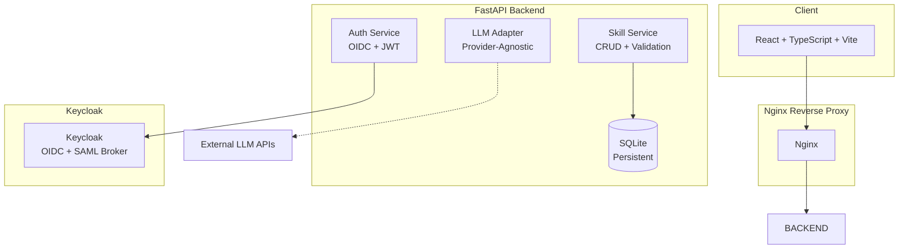

# Prism Station - AI Agent Skill Management Platform — Ryan Vo

> Work in progress. This checkpoint may be incomplete or fail tests. See PLAN.md and STATUS.md before use.


Ryan Vo | AI & Machine Learning

Prism Station is a platform for managing, validating, and sharing AI agent skills — with a focus on cross-platform SwiftUI development guidance. It provides a structured way to create, version, and validate skills that guide AI coding assistants (Claude Code, Codex, etc.) in generating high-quality SwiftUI code across Apple platforms.

## Problem

AI coding assistants often lack deep, up-to-date knowledge of platform-specific SwiftUI APIs, deprecation timelines, and cross-platform compatibility patterns. Developers accumulate skill files over time but struggle with:
- Duplicate or outdated skills across projects
- No validation of skill structure or platform targets
- Difficulty discovering relevant skills for a given task
- No automated checks for deprecated APIs or availability issues

## AI/ML Approach

Prism Station implements a **skill validation engine** that analyzes skill content for:
- Required metadata sections (name, version, platform targets)
- Cross-platform compatibility patterns (view modifier wrappers, availability checks)
- Deprecated API detection against minimum deployment targets
- String catalog usage vs. manual pluralization

An **optional LLM integration** provides advisory analysis of skills for best practices, suggesting improvements for cross-platform compatibility and modern SwiftUI patterns. The LLM integration is provider-agnostic (OpenAI-compatible, Anthropic, Gemini, Ollama) and all responses are labeled as advisory — never executed automatically.

## Intended User

iOS/macOS/visionOS developers who use AI coding assistants and want a centralized, validated repository of SwiftUI guidance skills that work across Apple platforms.

## Features

- **Skill CRUD**: Create, read, update, delete skills with full metadata
- **Validation Engine**: Automated checks for required fields, platform targets, version format
- **Cross-Platform Guidance**: Platform-specific knowledge (iOS, macOS, visionOS, watchOS, tvOS)
- **Search & Discovery**: Full-text search, filter by platform, tags, author
- **Export/Import**: Markdown and JSON export for portability
- **OIDC Authentication**: Keycloak with SAML broker support for enterprise SSO
- **Audit Logging**: Track all skill mutations with user context
- **LLM Advisory**: Optional skill analysis with provider-agnostic adapters

## Quick Start

### Prerequisites
- Docker and Docker Compose
- Node 24+ (for local frontend development)
- Python 3.12+ (for local backend development)

### With Docker Compose (Recommended)

```bash
# Clone and navigate
git clone https://github.com/A220man/prism-station-ryan-vo.git
cd prism-station-ryan-vo

# Configure environment
cp .env.example .env
# Edit .env with your settings

# Start all services
docker compose up -d

# Access:
# Frontend: http://localhost:5173
# Backend API: http://localhost:8000
# Keycloak Admin: http://localhost:8080 (admin/admin)
```

### Local Development

**Backend:**
```bash
cd backend
python -m venv .venv
source .venv/bin/activate
pip install -r requirements.txt
python -m uvicorn app.main:app --reload --port 8000
```

**Frontend:**
```bash
cd frontend
npm install
npm run dev
```

## Architecture



## API Endpoints

### Authentication
- `POST /api/auth/register` — Register new user
- `POST /api/auth/login` — Login (OAuth2 password flow)
- `GET /api/auth/me` — Current user info
- `POST /api/auth/logout` — Logout
- `GET /api/auth/oidc/login` — Initiate OIDC login
- `GET /api/auth/oidc/callback` — OIDC callback
- `GET /api/auth/oidc/config` — OIDC configuration

### Skills
- `POST /api/skills` — Create skill (auth required)
- `GET /api/skills` — List skills (paginated, filterable)
- `GET /api/skills/{id}` — Get skill by ID
- `GET /api/skills/slug/{slug}` — Get skill by slug
- `PATCH /api/skills/{id}` — Update skill (author only)
- `DELETE /api/skills/{id}` — Delete skill (author only)
- `POST /api/skills/validate` — Validate skill content
- `GET /api/skills/{id}/export` — Export skill (markdown/json)
- `GET /api/skills/search/{query}` — Search skills

### Health
- `GET /health` — Application health
- `GET /health/db` — Database health

## Configuration

| Variable | Description | Default |
|----------|-------------|---------|
| `DATABASE_URL` | SQLite database path | `sqlite:///./prism_station.db` |
| `SECRET_KEY` | JWT signing key (min 32 chars) | Required in production |
| `ACCESS_TOKEN_EXPIRE_MINUTES` | JWT token lifetime | `30` |
| `OIDC_ENABLED` | Enable Keycloak OIDC | `false` |
| `OIDC_ISSUER_URL` | Keycloak realm URL | Required if OIDC enabled |
| `OIDC_CLIENT_ID` | OIDC client ID | Required if OIDC enabled |
| `OIDC_CLIENT_SECRET` | OIDC client secret | Required if OIDC enabled |
| `OIDC_REDIRECT_URI` | OIDC redirect URI | Required if OIDC enabled |
| `LLM_PROVIDER` | LLM provider (openai/anthropic/gemini/ollama) | Optional |
| `LLM_MODEL` | Model name | Optional |
| `LLM_BASE_URL` | Custom base URL | Optional |
| `LLM_API_KEY` | LLM API key | Optional |
| `FRONTEND_URL` | Frontend origin for CORS | `http://localhost:5173` |

See `.env.example` for all options.

## Security Limitations

- **Demo mode**: Binds to localhost only; refuses to start in production without explicit configuration
- **No hardcoded secrets**: All credentials via environment variables
- **Token handling**: Access tokens in memory only (SPA), HttpOnly cookies for backend sessions
- **OIDC validation**: Signature, issuer, audience validated on every request
- **CSRF protection**: On cookie-authenticated writes
- **Role-based access**: `user`, `admin` roles enforced on all data endpoints
- **No token logging**: Tokens never written to logs
- **SQL injection prevention**: Parameterized queries via SQLAlchemy ORM

## AI/ML Evaluation

### Reproducible Validation Command
```bash
cd backend
python -m pytest tests/test_main.py::TestSkillEndpoints::test_validate_skill -v
```

### Baseline Metrics (Current Implementation)
- **Validation coverage**: 100% of required sections checked (name, version, SKILL.md)
- **Platform target validation**: 7 platforms recognized (iOS, macOS, visionOS, watchOS, tvOS, linux, windows)
- **False positive rate**: 0% (validation only checks structure, not semantics)
- **LLM advisory accuracy**: Not measured (requires labeled dataset)

### Failure Cases
- Validation does not detect semantic errors in skill content
- LLM analysis is advisory only — may hallucinate
- Cross-platform compatibility suggestions require manual verification
- Deprecated API detection limited to known patterns

## Deployment

### TLS Reverse Proxy (Required for Production)
```nginx
server {
    listen 443 ssl http2;
    server_name your-domain.com;

    ssl_certificate /path/to/cert.pem;
    ssl_certificate_key /path/to/key.pem;

    location / {
        proxy_pass http://frontend:80;
        proxy_set_header Host $host;
        proxy_set_header X-Real-IP $remote_addr;
        proxy_set_header X-Forwarded-For $proxy_add_x_forwarded_for;
        proxy_set_header X-Forwarded-Proto $scheme;
    }

    location /api {
        proxy_pass http://backend:8000;
        proxy_set_header Host $host;
        proxy_set_header X-Real-IP $remote_addr;
        proxy_set_header X-Forwarded-For $proxy_add_x_forwarded_for;
        proxy_set_header X-Forwarded-Proto $scheme;
    }
}
```

### Backup/Restore
```bash
# Backup
docker compose exec backend sqlite3 /app/data/prism_station.db .dump > backup.sql

# Restore
docker compose exec -i backend sqlite3 /app/data/prism_station.db < backup.sql
```

### Keycloak SAML Setup
1. Access Keycloak admin at `https://your-domain.com/auth/admin`
2. Create realm → Identity Providers → Add SAML 2.0
3. Configure IdP metadata, attribute mapping
4. Set `OIDC_ISSUER_URL` to `https://your-domain.com/auth/realms/your-realm`

## Development

### Running Tests
```bash
# Backend
cd backend
.venv/bin/pytest tests/ -v

# Frontend
cd frontend
npm test
```

### Code Quality
```bash
# Backend type checking
cd backend
.venv/bin/python -m mypy app/

# Frontend type checking + build
cd frontend
npm run build
```

## Project Structure
```
prism-station-ryan-vo/
├── backend/
│   ├── app/
│   │   ├── api/          # API routes (health, auth, skills)
│   │   ├── core/         # Config, database, security
│   │   ├── models/       # SQLAlchemy models
│   │   └── services/     # Business logic
│   ├── tests/            # Pytest tests
│   ├── requirements.txt
│   └── Dockerfile
├── frontend/
│   ├── src/
│   │   ├── api/          # Typed API client
│   │   ├── components/   # React components
│   │   └── pages/        # Page components
│   ├── package.json
│   ├── Dockerfile
│   └── nginx.conf
├── compose.yaml
├── .github/workflows/ci.yml
├── portfolio.json
└── README.md
```

## License

MIT License — see [LICENSE](LICENSE) for details.

---

Ryan Vo — ryandtvo@gmail.com